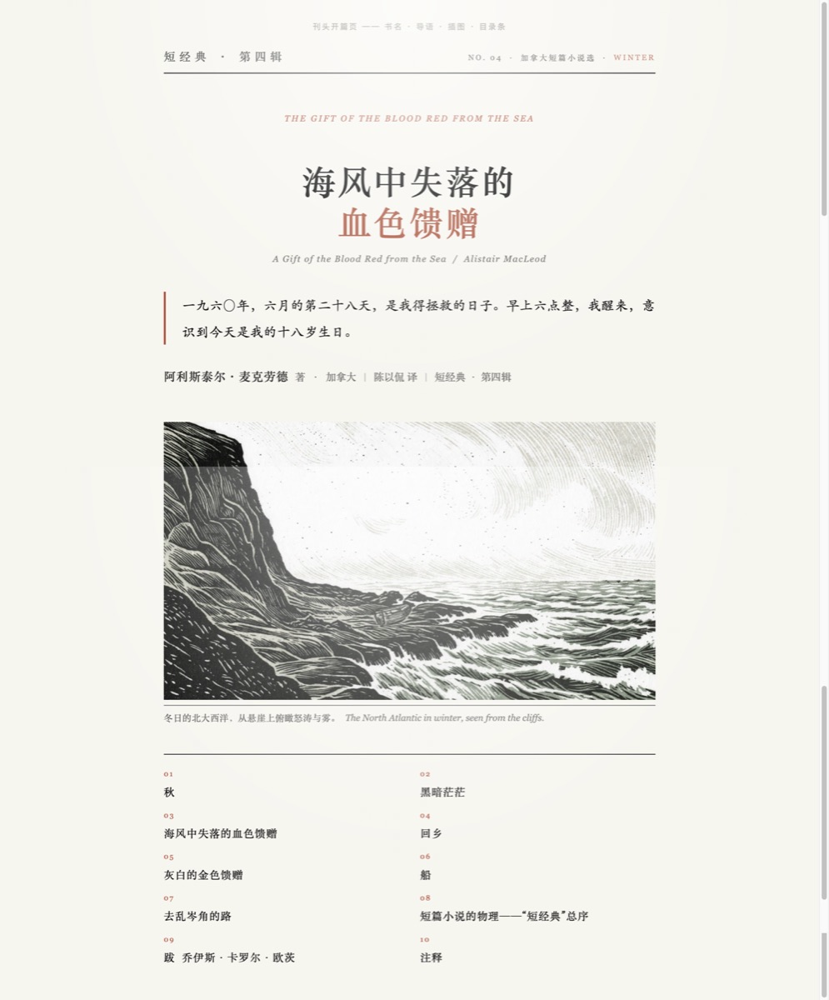
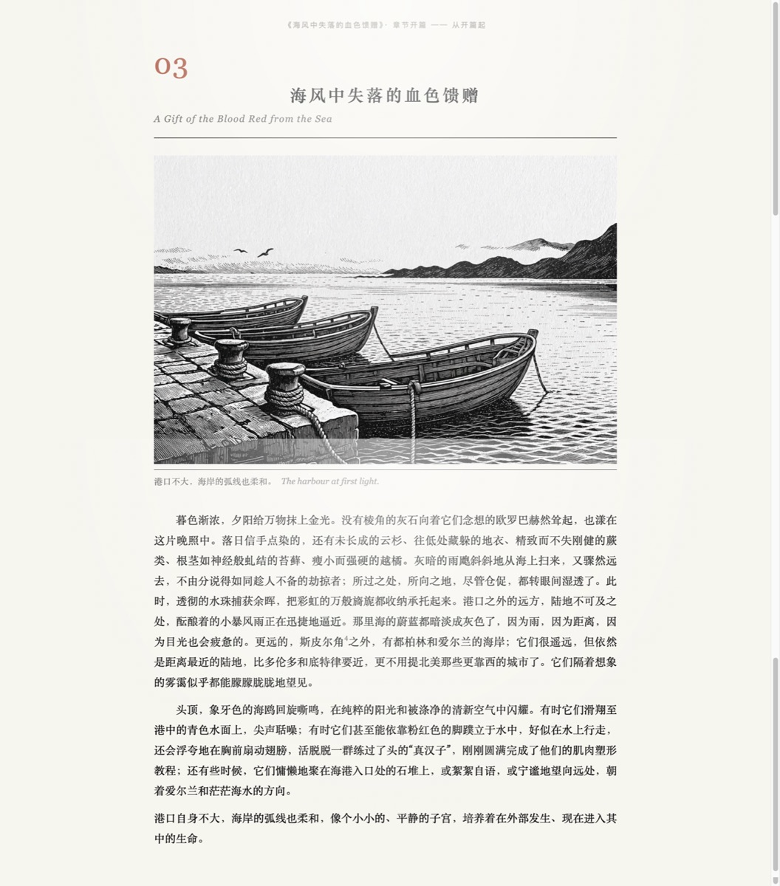
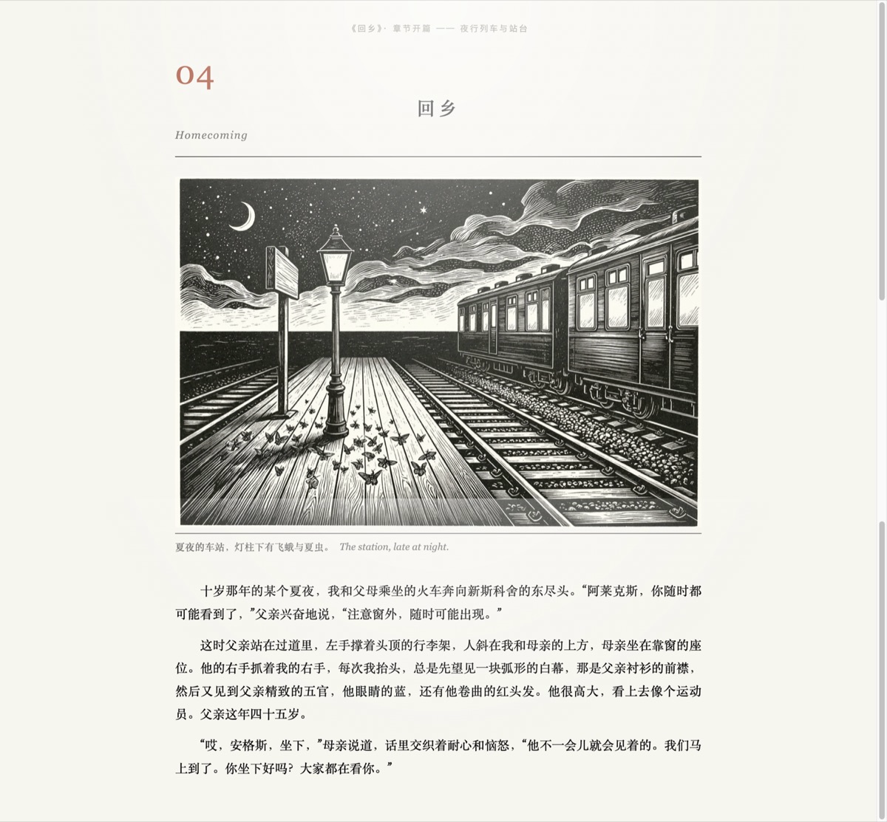
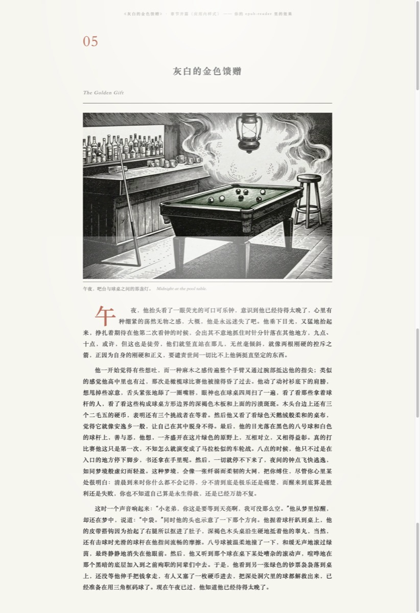

# magazine-epub

把已有 EPUB 重排成杂志版，按需加上统一风格的章首插画、双语图注和刊头页。「画入纸面」的 Kindle 轻量版默认使用纯白底湿边。



---

## 它解决什么

从各处流传来的 EPUB（尤其是经过转换器处理的中文旧书）通常有三个问题：

| 问题 | 表现 | 本 skill 的处理 |
| --- | --- | --- |
| 排版是转换器默认值 | 标题是 `<p>` 不是 `<h1>`；章节靠空行分隔；链接是写死的 `#00c` 蓝 | 标题语义化，样式表整体重写 |
| 夹带推广内容 | 公众号广告段落或广告页 | 先核对命中的内容，再清理确认是广告的段落或页面 |
| 需要章首配图 | 已有图片不足 | 先复用适合的原图，按用户确认的范围补图 |

外加一条容易被忽略的：**很多阅读器会把书里的样式盖掉**。epubjs 会用 `!important` 强制字体与行距，会给 `<h1>` 注入装饰，还会让首字下沉打到标题的第一个字上。这份样式表和配套文档都按这些坑设计过。

---

## 产出长什么样

**刊头开篇页** — 刊头条 / 巨标题 / 英文题名 / 导语 / 作者行 / 满幅主图 / 目录条



**章节扉页** — 朱砂章号 / 中英章名 / 专属插画（宽度与正文栏一致）/ 双语图注，正文保持原样往下排



**在 epubjs 阅读器里** — 样式表与阅读器注入的主题、字体、行距共存，夜间与护眼模式自动反色



> 演示截图含少量受版权保护文本作为版式示例。

---

## 安装

仓库里的 skill 放在 `skills/magazine-epub/` 目录（目录名与 skill 名一致），结构符合 agents.md 规范。把它放进任意 harness 的 skills 根目录即可：

```bash
# 通用（Codex / Cursor / Claude Code / MCode 等读 ~/.agents/skills 的）
git clone https://github.com/a998151/magazine-epub.git
cp -R magazine-epub/skills/magazine-epub ~/.agents/skills/

# 其他 harness（~/.codex/skills、~/.claude/skills 等）同理，放到对应根目录
```

装完新开一个会话，说一句「把这个 epub 做成杂志版」就会触发。

---

## 用法

### 方式一：交给 agent（推荐）

直接说需求即可，触发词例如：

- 「把 `某书.epub` 做成杂志版排版」
- 「每章配一张插画，风格要统一」
- 「这本书要传 Kindle，帮我排一下版」
- 「给这本 EPUB 加刊头开篇页和章节插图」

先确认版式和是否生成插画。构建、打包和校验完成后，预览直接从交付的 EPUB 渲染。

### 方式二：手动跑脚本

```bash
cd skills/magazine-epub

# 1) 体检：章节表、样式类分布、推广词、重复目录页
python3 scripts/inspect_epub.py /path/to/book.epub

# 2) 按体检结果写配置
$EDITOR config.json

# 3) 构建（自带结构自检，不过则退出码非 0）
python3 scripts/build_epub.py --config config.json
```

以下配置为一个章节加图。完整字段见 [构建配置](skills/magazine-epub/references/recipes.md)。

```json
{
  "source": "/path/to/book.epub",
  "workdir": "/path/to/new-build-dir",
  "output": "/path/to/book_magazine.epub",
  "chapters": [{
    "file": "index_split_003.html", "no": "01", "cn": "秋", "en": "Autumn",
    "image": "illust-coast", "alt": "插图描述",
    "caption_cn": "图注中文。", "caption_en": "Caption in English."
  }],
  "images": { "illust-coast": "/abs/path/illust-coast.jpg" }
}
```

---

## 「画入纸面」Kindle 轻量版

```bash
python3 scripts/layout_style.py book_magazine.epub --preset paper-wash -o book_wash.epub
python3 scripts/kindle_compact.py book_wash.epub -o book_kindle.epub
python3 scripts/layout_style.py book_kindle.epub --preview kindle.html --layouts original
```

轻量化默认将非封面 JPG/PNG 限在长边 1100 px、单张 160 KiB 内。画入纸面的湿边保留窄过渡，外围清成纯白并写入 PNG。如需透明版，从 `book_wash.epub` 加 `--wet-edge alpha` 另存。 [版式和轻量化参数](skills/magazine-epub/references/layouts.md)

---

## 兼容性

| 阅读器 | 表现 |
| --- | --- |
| Kindle | 使用单栏。实际字体、边距与分页以实机为准 |
| epubjs（WebView） | 字号是 body 上的行内样式，能覆盖；font-family / line-height 被 `!important` 强制；`<h1>` 会被注入装饰伪元素；首字下沉默认命中页面第一个段落 |
| Apple Books / 微信读书 / Kobo | 基本按标准 CSS 走 |

完整说明见 [阅读器兼容性](skills/magazine-epub/references/compatibility.md)。

---

## 目录结构

```
magazine-epub/
├── README.md
├── docs/                      演示截图
└── skills/
    └── magazine-epub/         目录名 = skill 名，可直接 cp 到任意 skills 根目录
        ├── SKILL.md           工作流程与验收
        ├── agents/openai.yaml 跨 harness 展示元信息
        ├── scripts/
        │   ├── inspect_epub.py 体检器
        │   ├── build_epub.py   配置驱动构建器
        │   ├── layout_style.py 换版与成品预览
        │   └── kindle_compact.py Kindle 轻量化
        └── references/
            ├── magazine.css   杂志版样式表（构建时注入）
            ├── page.css       @page 分页样式
            ├── recipes.md     配置字段表 + 插画/图注策划方法
            ├── layouts.md     版式预设与 Kindle 轻量化参数
            └── compatibility.md 阅读器兼容要点
```

**依赖**：Python 3。画入纸面与 Kindle 轻量化需要 Pillow。新增插画使用所在环境可用的图像生成工具。

---

## 下一步：转成 HTML

杂志版 EPUB 可以再转成**单文件、可离线打开**的 HTML 阅读器（双击即读，带目录抽屉、
主题切换、插图放大），用配套的 [`magazine-html`](https://github.com/a998151/magazine-html) skill：

```bash
git clone https://github.com/a998151/magazine-html.git
cp -R magazine-html/skills/magazine-html ~/.agents/skills/
```

两条 skill 是一条流水线的两段：`原始 EPUB →（magazine-epub）→ 杂志版 EPUB →（magazine-html）→ 单文件 HTML`。

---

## License

尚未指定 License。公开发布前请自行添加一个（如 MIT），或在 README 里注明保留所有权利。
